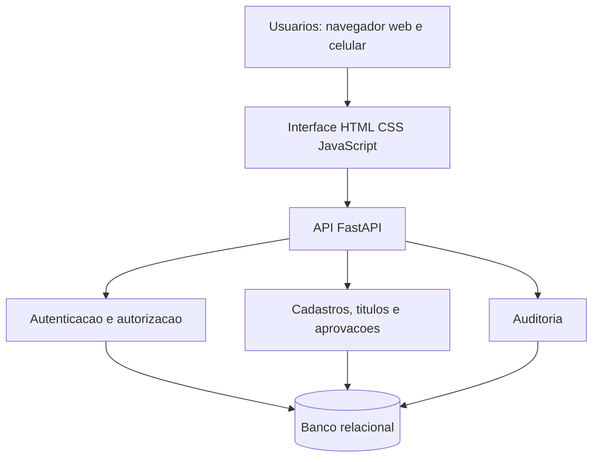
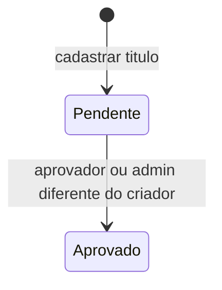

# ERP Finance — Documentação funcional e técnica

**Versão documentada:** 0.2  
**Data de referência:** 25/11/2026  
**Situação:** desenvolvimento / pré-homologação  
**Idioma:** português brasileiro | **Moeda inicial:** BRL

> Documento consolidado a partir das definições do produto e dos códigos apresentados nas versões 0.1 e 0.2. As funcionalidades futuras são requisitos propostos, não entregas concluídas. Os arquivos originais não estavam disponíveis no ambiente desta revisão; portanto, não houve nova execução dos testes nem inspeção independente do pacote distribuído anteriormente.

## 1. Visão do produto

O ERP Finance é uma aplicação de gestão financeira e contabilidade gerencial destinada a empresas de diferentes segmentos. O produto deve atender inicialmente de 4 a 10 usuários, com acesso por navegador em computadores, tablets e celulares, e evoluir para comercialização como SaaS (Software as a Service).

### Objetivos

- Centralizar informações financeiras e reduzir controles paralelos em planilhas.
- Integrar contas a pagar, contas a receber, tesouraria, conciliação, orçamento e contratos.
- Produzir informações gerenciais confiáveis por empresa, filial, centro de custos e período.
- Segregar funções, controlar aprovações e garantir rastreabilidade das operações.
- Preparar a plataforma para múltiplos contratantes, sem compartilhamento indevido de dados.
- Permitir importação de extratos bancários inicialmente e integração automática posteriormente.

### Limites de escopo

O foco é financeiro e contabilidade gerencial. Escrituração contábil oficial, obrigações fiscais, emissão de documentos fiscais, folha de pagamento, estoque, pagamentos bancários automáticos e integrações específicas não estão implementados nem fazem parte da entrega inicial. Exportações contábeis futuras não substituem a validação do contador responsável.

## 2. Identidade e experiência do usuário

| Elemento | Definição |
|---|---|
| Nome provisório/comercial | ERP Finance |
| Azul principal | `#173B70` |
| Azul secundário | `#245BA3` |
| Cinza de apoio | `#64748B` |
| Fundo | `#EEF2F7` |
| Interface | Web responsiva, em português |
| Navegação | Login, empresa ativa, módulos e ações conforme perfil |

A interface efetiva da v0.2 é HTML/CSS/JavaScript, com menu de navegação, formulários e tabelas. Os protótipos anteriores com menu lateral, gráficos avançados e cartões gerenciais são referências de design, não representação integral das telas entregues.

## 3. Evolução até o momento

| Versão | Entregas descritas | Limitações |
|---|---|---|
| 0.1 | Arquitetura preliminar, protótipo visual, API de inclusão e consulta de títulos, PostgreSQL e Docker | Chave de desenvolvimento, contratante fixo, sem interface conectada ou login real |
| 0.2 | Interface conectada à API, login, sessões, empresas, usuários, perfis, cadastros básicos, títulos, aprovação e auditoria | Sem liquidação financeira, migração automática, permissões granulares ou homologação de produção |

## 4. Arquitetura tecnológica

Adota-se inicialmente uma aplicação monolítica, com evolução planejada para monólito modular. Isso reduz a complexidade de instalação e operação. A separação por domínios e serviços deverá ser aprofundada conforme o produto crescer.



| Camada | Implementação v0.2 | Evolução prevista |
|---|---|---|
| Interface | HTML, CSS, JavaScript | React, Next.js, TypeScript, Tailwind CSS |
| API | Python / FastAPI | Serviços por domínio, contratos de API versionados |
| Banco | SQLite local; PostgreSQL 16 configurado em Docker | PostgreSQL homologado, RLS e índices revisados |
| Acesso a dados | SQLAlchemy com SQL parametrizado | Modelos e repositórios organizados |
| Migrações | Criação inicial via `schema.sql` | Alembic e migrações versionadas |
| Identidade | Senha scrypt e token de sessão | MFA, recuperação de senha, gestão de sessões; OIDC a avaliar |
| Infraestrutura | Docker / Compose | Hospedagem, HTTPS, monitoramento e backups |
| Arquivos | Não implementado | Armazenamento protegido de anexos |
| Controle de versão | Recomendado Git/GitHub | CI/CD e releases rastreáveis |

### Estrutura do pacote v0.2

```text
erp-finance-v0.2/
  main.py           # API, autenticação e regras iniciais
  index.html        # interface responsiva
  schema.sql        # criação das tabelas
  requirements.txt  # dependências Python
  Dockerfile        # imagem da aplicação
  compose.yaml      # aplicação e PostgreSQL
  README.md         # instruções e limitações
  test_smoke.py     # testes iniciais da API
```

## 5. Modelo multiempresa e SaaS

- **Contratante (tenant):** ambiente lógico de um cliente da plataforma.
- **Empresa:** pessoa jurídica pertencente a um contratante.
- **Filial:** cadastro básico associado a uma empresa; ainda não participa da classificação dos títulos.
- **Usuário:** pertence a um contratante e possui um perfil fixo.

Na v0.2, a API obtém o contratante a partir da sessão autenticada e filtra consultas por `tenant`. Nas operações por empresa, verifica se a empresa pertence ao mesmo contratante. O usuário não escolhe livremente o tenant no corpo da requisição.

**Limite atual:** todos os usuários de um contratante têm acesso de consulta a todas as suas empresas. Não há provisionamento comercial de novos contratantes pela interface; apenas o ambiente inicial é criado automaticamente. A estrutura não constitui isolamento SaaS plenamente homologado.

**Requisito futuro:** autorização por empresa/filial, políticas de isolamento no banco (RLS), chaves relacionais que impeçam vínculos cruzados, administração segura de contratantes, assinatura, limites de usuários e testes sistemáticos de isolamento.

## 6. Modelo de dados atual

| Tabela | Campos principais | Finalidade |
|---|---|---|
| `tenants` | id, name | Contratantes |
| `users` | id, tenant, email, password, role | Identidade e perfil |
| `sessions` | id, user_id, expires | Sessões autenticadas |
| `companies` | id, tenant, name, document | Empresas/CNPJs |
| `registers` | id, tenant, company, kind, name, document | Cadastros financeiros genéricos |
| `entries` | id, tenant, company, description, kind, amount, due_date, status, creator | Títulos financeiros |
| `audit` | id, tenant, actor, action, ref, ts | Eventos de auditoria |

Relacionamentos principais: contratante 1:N empresas e usuários; usuário 1:N sessões; empresa 1:N cadastros e títulos. A auditoria registra ator, contratante, ação, referência e instante do evento.

### Convenções de dados

- Identificadores gerados pela aplicação como valores hexadecimais aleatórios de 32 caracteres.
- Valores financeiros recebidos como `Decimal`, positivos e com até duas casas decimais; persistidos como inteiro em centavos. Exemplo: R$ 123,45 = 12345.
- Vencimentos armazenados em formato ISO `AAAA-MM-DD`.
- Eventos de auditoria e expiração de sessão registrados em segundos Unix.
- E-mail de login normalizado para minúsculas e único globalmente.
- CNPJ/documento é campo textual; não há validação completa de dígitos verificadores ou unicidade cadastral.

### Modelo futuro (não implementado)

Entidades especializadas para clientes, fornecedores, filiais, contas bancárias, plano de contas, centros de custos, rateios, títulos, parcelas, baixas, movimentações bancárias, conciliações, contratos, faturamento, orçamento, aprovações e anexos. Devem ser adicionadas por migrações, preservando a integridade dos registros existentes.

## 7. Autenticação, autorização e auditoria

### 7.1 Autenticação

1. O usuário informa e-mail e senha.
2. A API consulta o usuário e valida a senha com scrypt, salt aleatório e comparação de tempo constante.
3. Em caso de sucesso, gera token aleatório e armazena seu hash SHA-256 na tabela de sessões.
4. A interface mantém o token em memória e envia `Authorization: Bearer <token>` nas chamadas.
5. A sessão expira após oito horas; o logout remove a sessão do banco.
6. Requisições sem sessão válida retornam HTTP 401; falta de permissão retorna HTTP 403.

O administrador inicial é criado no primeiro boot de um banco sem usuários, com credenciais fornecidas por variáveis de ambiente. A senha inicial deve ter pelo menos 12 caracteres. Não há recuperação de senha, troca obrigatória de senha inicial, MFA ou limitação de tentativas implementadas.

### 7.2 Matriz de permissões atual

| Ação | Admin | Financeiro | Aprovador | Auditoria |
|---|:---:|:---:|:---:|:---:|
| Consultar empresas, cadastros e títulos | Sim | Sim | Sim | Sim |
| Consultar dashboard | Sim | Sim | Sim | Sim |
| Cadastrar empresas | Sim | Não | Não | Não |
| Consultar e criar usuários | Sim | Não | Não | Não |
| Criar cadastros e títulos | Sim | Sim | Não | Não |
| Aprovar título de outro usuário | Sim | Não | Sim | Não |
| Consultar eventos de auditoria | Sim | Não | Não | Sim |

A autorização é verificada no servidor. Ocultar botões na interface é apenas uma medida de usabilidade. Não existem ainda perfis personalizáveis, desativação de usuários, escopo por empresa ou alçadas por valor.

### 7.3 Auditoria

Eventos gravados na v0.2: `company.create`, `user.create`, `register.create`, `entry.create`, `entry.approve`. A operação e o evento são gravados na mesma transação de banco. A consulta é restrita a admin e auditoria, por contratante.

Ainda não há trilha completa de login, alterações antes/depois, anexos, exportações, acessos de leitura ou mecanismos de imutabilidade. A tabela não deve ser tratada como evidência inviolável.

## 8. Módulos e regras de negócio atuais

### 8.1 Dashboard

Exibe os títulos cadastrados para a empresa ativa:

- Receitas cadastradas = soma dos títulos `receivable`.
- Despesas cadastradas = soma dos títulos `payable`.
- Diferença nominal = receitas cadastradas − despesas cadastradas.

Inclui títulos pendentes e aprovados, sem filtro temporal no cálculo atual. Não representa saldo bancário, caixa realizado, lucro, DRE ou disponibilidade financeira.

### 8.2 Cadastros

A tabela `registers` permite cadastrar e consultar clientes, fornecedores, centros de custos, contas do plano de contas, contas bancárias e filiais, vinculados à empresa ativa. Cada registro possui tipo, nome e documento/código opcional. Não há edição, exclusão, hierarquia, campos especializados, saldos bancários ou vínculo obrigatório desses cadastros com títulos.

### 8.3 Contas a pagar e receber

Campos atuais: empresa, descrição, tipo (`payable`/`receivable`), valor positivo, vencimento, situação e criador. Admin e financeiro podem cadastrar títulos. A consulta é filtrada por empresa e ordenada por vencimento. A interface separa receitas e despesas.

### 8.4 Aprovação



Todo título nasce `pendente`. A aprovação altera para `aprovado` somente se o registro pertencer ao contratante autenticado, estiver pendente e o aprovador for diferente do criador. A atualização é condicional no banco, evitando aprovação repetida. Caso não seja possível, retorna HTTP 409. A aprovação atual não executa pagamento, não altera saldo e não gera baixa.

### 8.5 Situação geral dos módulos

| Módulo | Situação na v0.2 |
|---|---|
| Login e usuários | Base funcional |
| Multiempresa | Base funcional, com limitações de escopo |
| Cadastros e centros de custos | Inclusão e consulta básicas |
| Contas a pagar e receber | Inclusão, consulta e aprovação simples |
| Dashboard | Indicadores nominais básicos |
| Auditoria | Eventos básicos |
| Fluxo de caixa / tesouraria | Planejado |
| Conciliação bancária | Planejado |
| DRE gerencial | Planejado |
| Orçamento | Planejado |
| Contratos e faturamento | Planejado |
| Relatórios contábeis | Planejado |
| SaaS comercial | Planejado |

## 9. Regras de negócio propostas para evolução

As regras abaixo são uma especificação inicial para desenvolvimento e homologação. Devem ser validadas com a operação financeira antes de serem tratadas como requisitos definitivos.

### 9.1 Núcleo financeiro (v0.3)

- Registrar competência, emissão, vencimento, contraparte, conta contábil gerencial, centro de custos e empresa.
- Parcelamentos: gerar parcelas individualizadas, distribuindo diferenças de arredondamento de modo que a soma seja exatamente igual ao valor contratado.
- Recorrências: parametrizar periodicidade e vigência, com chave de idempotência para evitar geração duplicada de títulos.
- Rateios: soma dos percentuais = 100%; soma dos valores rateados = valor original, em centavos.
- Separar situação de aprovação da situação de liquidação e calcular atraso a partir do vencimento e do saldo aberto.
- Baixas parciais ou totais: registrar data, conta bancária, principal amortizado, juros, multa, desconto e comprovante. Não permitir amortização acima do saldo aberto.
- Fórmula proposta: valor efetivo da baixa = principal amortizado + juros + multa − desconto. Saldo aberto = principal original − principal amortizado acumulado (considerando estornos e ajustes autorizados).
- Estorno deve registrar movimento compensatório vinculado à baixa original, com motivo e usuário; não apagar histórico financeiro.
- Cancelamentos não podem eliminar títulos já liquidados sem o tratamento prévio das baixas.
- Alçadas: definir faixas de valor, aprovadores e exigência de aprovação múltipla; proibir autoaprovação e registrar decisão.
- Inadimplência: saldo aberto de recebíveis vencidos na data-base. Aging sugerido: a vencer, 1–30, 31–60, 61–90 e acima de 90 dias.
- Exportação Excel e filtros por empresa, competência, vencimento, contraparte, status e classificação.

**Exemplo:** título de R$ 1.000,00; primeira baixa amortiza R$ 400,00 e cobra R$ 10,00 de juros. Caixa recebido = R$ 410,00; saldo principal aberto = R$ 600,00.

### 9.2 Tesouraria e fluxo de caixa (v0.4)

- Regime de caixa considera a data efetiva da movimentação financeira; previsão considera os vencimentos ou datas estimadas dos títulos em aberto.
- Saldo final realizado = saldo inicial + entradas realizadas − saídas realizadas.
- Saldo projetado = saldo realizado na data-base + entradas futuras previstas − saídas futuras previstas.
- Evitar dupla contagem de títulos já liquidados na projeção.
- Transferências internas devem produzir movimentos correspondentes em contas de origem e destino, sem inflar receitas/despesas consolidadas.
- Permitir posição por banco, empresa, filial e visão consolidada; regras de operações intercompany devem ser definidas antes da consolidação.

### 9.3 Conciliação bancária (v0.5)

Importar arquivos OFX, CSV e Excel conforme layouts homologados, preservando origem, conta bancária, identificador externo, data, valor e descrição. Validar formato e duplicidade antes de confirmar importação.

Ordem proposta de correspondência: identificador externo inequívoco; combinação de valor/data/contraparte; revisão manual quando houver múltiplos candidatos ou divergências. Tolerâncias e janelas de data deverão ser parametrizadas. Permitir conciliação 1:1, 1:N e N:1 somente com igualdade de valores ou ajustes autorizados e documentados.

Situações propostas: importado, candidato, conciliado, divergente, ignorado com justificativa. Integração por API/webhook é futura e depende do provedor bancário, credenciais e contratos aplicáveis.

### 9.4 DRE e contabilidade gerencial (v0.6)

O plano de contas gerencial deverá ser hierárquico e parametrizar a classificação de receitas, deduções, custos e despesas. A DRE será apurada por competência, independentemente do pagamento ou recebimento, conforme critérios de reconhecimento validados pela empresa.

```text
Receita bruta
(-) Deduções da receita
(=) Receita líquida
(-) Custos diretos
(=) Resultado bruto
(-) Despesas operacionais (exceto depreciação/amortização)
(=) EBITDA gerencial, conforme composição definida
(-) Depreciação e amortização
(=) Resultado operacional
(+/-) Resultado financeiro e demais itens aplicáveis
(-) Tributos sobre o lucro, quando aplicáveis
(=) Resultado líquido
```

A estrutura é ilustrativa; classificação, reconhecimento, tributos e ajustes devem ser parametrizados e reconciliados com a contabilidade. Não usar vencimento como substituto automático da competência. Implementar bloqueio de períodos fechados e reabertura autorizada com auditoria.

### 9.5 Orçamento empresarial (v0.7)

Planejamento mensal por empresa, conta gerencial e centro de custos. Manter versões e revisões aprovadas, sem sobrescrever orçamento original. Desvio nominal = realizado − orçado; desvio percentual = (realizado − orçado) / orçado × 100, quando o orçamento não for zero. Classificar favorabilidade conforme natureza de receita ou despesa e apresentar ausência de base quando orçamento = zero.

### 9.6 Contratos e faturamento (v0.8)

Cadastro de cliente, objeto, vigência, valor, periodicidade, reajuste e condições de cobrança. Geração de recebíveis a partir de eventos de faturamento, com identificador único para impedir duplicidades. Tratar suspensão, renovação, rescisão, alteração contratual e receitas recorrentes. Faturamento financeiro não equivale à emissão de nota fiscal.

### 9.7 Relatórios e controles avançados (v0.9)

Relatórios de contas a pagar/receber, aging, caixa, conciliação, DRE, orçamento, posição de contratos, auditoria e exportações para contabilidade. Exigir filtros, data-base, empresa, moeda, critérios de regime, totais reconciliáveis e respeito às permissões. Exportações em Excel/PDF previstas; nenhuma implementada na v0.2.

## 10. API atual (v0.2)

| Método | Rota | Finalidade / autorização |
|---|---|---|
| GET | `/` | Interface web |
| POST | `/api/login` | Autenticação pública |
| POST | `/api/logout` | Encerrar sessão autenticada |
| GET | `/api/me` | Identidade autenticada |
| GET | `/api/companies` | Empresas do contratante |
| POST | `/api/companies` | Criar empresa (admin) |
| GET | `/api/users` | Listar usuários (admin) |
| POST | `/api/users` | Criar usuário (admin) |
| GET | `/api/registers/{co}` | Consultar cadastros da empresa |
| POST | `/api/registers` | Criar cadastro (admin/financeiro) |
| GET | `/api/entries/{co}` | Consultar títulos da empresa |
| POST | `/api/entries` | Criar título (admin/financeiro) |
| POST | `/api/entries/{i}/approve` | Aprovar título (admin/aprovador) |
| GET | `/api/audit` | Consultar auditoria (admin/auditoria) |

`{co}` representa o ID da empresa; `{i}`, o ID do título. Exceto login e interface pública, as rotas exigem token válido. A documentação interativa FastAPI normalmente está disponível em `/docs` no ambiente de desenvolvimento.

Exemplo de corpo para criação de título (dados fictícios):

```json
{
  "company": "ID_DA_EMPRESA_AUTORIZADA",
  "description": "Prestação de serviços",
  "kind": "receivable",
  "amount": "1500.00",
  "due_date": "2026-12-10"
}
```

Códigos relevantes: 200 sucesso, 401 sessão/credenciais inválidas, 403 permissão insuficiente, 404 empresa inexistente ou fora do contratante, 409 conflito, 422 dados inválidos. A v0.1 utilizava rotas e autenticação diferentes; não há compatibilidade automática.

## 11. Instalação e operação local

> Ambiente de desenvolvimento exclusivamente. Não usar dados reais nem expor a aplicação à internet.

Pré-requisitos: código-fonte v0.2, Docker e Docker Compose. Na pasta do projeto, criar `.env` com:

```dotenv
ERP_ADMIN_EMAIL=admin@example.com
ERP_ADMIN_PASSWORD=SUBSTITUIR_POR_SENHA_FORTE
DB_PASSWORD=SUBSTITUIR_POR_SENHA_ALEATORIA_ALFANUMERICA
```

Usar credenciais próprias; não versionar `.env`. A senha do banco deve ser compatível com a URL de conexão da implementação atual.

```bash
docker compose up --build
```

Acessar `http://localhost:8000` no navegador. A porta está configurada para loopback local. O volume PostgreSQL mantém os dados entre reinicializações. Para parar, executar `docker compose down`; não utilizar `-v` se desejar preservar o banco.

Alternativa com Python 3.11+ e SQLite:

```bash
pip install -r requirements.txt
# Definir ERP_ADMIN_EMAIL e ERP_ADMIN_PASSWORD no ambiente.
uvicorn main:app --host 127.0.0.1 --port 8000
```

A v0.2 deve usar banco novo; não há migração automática dos registros v0.1. Preservar o banco anterior. A senha de administrador é aplicada na inicialização do banco vazio, não redefine senha existente.

## 12. Testes e critérios de qualidade

A entrega anterior relatou aprovação de testes básicos com SQLite: sintaxe Python, login, bloqueio sem sessão, cadastro de usuário e cliente, armazenamento em centavos, criação e aprovação de título, bloqueio por perfil, isolamento entre dois contratantes nos cenários exercitados e logout. O código de teste apresentado não verifica todos os fluxos financeiros nem todos os casos de autoaprovação e isolamento possíveis.

O teste fornecido chama-se `test_smoke.py` e pode ser executado com `python test_smoke.py` em ambiente com as dependências instaladas, incluindo `httpx` para o cliente de testes. Usa banco temporário e dados fictícios. A execução não foi repetida nesta documentação.

### Critérios mínimos para homologação

- Testar PostgreSQL real, migrações, persistência, concorrência e rollback.
- Testar cada rota por perfil, contratante e empresa, incluindo tentativas de acesso cruzado e alteração de identificadores.
- Testar criação, autoaprovação, aprovação duplicada, sessão expirada e logout.
- Testar arredondamento, parcelas, rateios, baixas parciais, estornos e duplicidades quando implementados.
- Validar relatórios contra uma base financeira conhecida e reconciliada.
- Testar navegadores, celulares, acessibilidade, desempenho e recuperação de falhas.
- Executar análise de dependências, revisão de código e testes de segurança.
- Validar backup e restauração antes de liberar o ambiente.

## 13. Segurança, LGPD e requisitos não funcionais

Antes de produção, implementar e homologar: HTTPS, MFA, limitação de tentativas de login, recuperação e revogação administrativa de acesso, gestão segura de segredos, autorização granular, RLS PostgreSQL, auditoria protegida, política de retenção, backup criptografado e testes de restauração, observabilidade e resposta a incidentes.

Definir papéis de controlador/operador, finalidade e minimização de dados pessoais, direitos dos titulares, política de acesso, tratamento de incidentes e contratos com fornecedores de infraestrutura. A existência de login ou segregação lógica não implica conformidade automática com a LGPD.

Metas de disponibilidade, desempenho, capacidade, RPO (perda máxima tolerável de dados) e RTO (tempo máximo de recuperação) ainda precisam ser acordadas. Não há SLA comercial definido.

## 14. Roadmap

| Versão | Objetivo | Situação |
|---|---|---|
| 0.1 | Arquitetura, protótipo e API inicial | Entrega descrita |
| 0.2 | Interface, autenticação, cadastros, multiempresa e permissões | Base de desenvolvimento entregue anteriormente |
| 0.3 | Núcleo de contas a pagar e receber | Próxima etapa |
| 0.4 | Tesouraria e fluxo de caixa | Planejado |
| 0.5 | Conciliação bancária | Planejado |
| 0.6 | DRE e contabilidade gerencial | Planejado |
| 0.7 | Orçamento empresarial | Planejado |
| 0.8 | Contratos e faturamento | Planejado |
| 0.9 | Relatórios e controles avançados | Planejado |
| 1.0 | Homologação, segurança e implantação piloto | Planejado |
| 2.0 | Comercialização SaaS | Planejado |

A segurança, as migrações e os testes devem evoluir transversalmente desde a próxima versão, e não ser postergados integralmente até a v1.0.

## 15. Decisões pendentes e riscos

| Tema | Pendência |
|---|---|
| Infraestrutura | Selecionar hospedagem, ambientes e responsáveis técnicos |
| Front-end | Validar manutenção da interface atual ou migração para React/Next.js |
| Banco | Homologar PostgreSQL e definir estratégia de migrações |
| Segurança | Implementar controles de produção e isolamento em profundidade |
| Cadastros | Definir campos obrigatórios, edição, inativação, unicidade e classificação |
| Financeiro | Validar competência, regras de juros, rateios, liquidações e alçadas |
| Conciliação | Definir bancos, layouts e critérios de correspondência |
| Contabilidade | Validar plano de contas, DRE, exportações e fechamento |
| Comercial | Definir planos, preços, contratos, suporte e propriedade intelectual |

## 16. Próxima entrega recomendada — v0.3

Priorizar a recuperação do repositório v0.2, criação de migrações e testes de regressão; depois, evoluir o modelo financeiro com contraparte, competência, classificação, parcelas, baixas e histórico. Implementar regras de integridade e autorização juntamente com as funcionalidades. Homologar com dados sintéticos antes de qualquer piloto com dados reais.

**Definição de pronto sugerida:** código versionado, migração reproduzível, documentação atualizada, testes automatizados aprovados em PostgreSQL, fluxos de interface validados e limitações registradas. A liberação para produção depende de revisão técnica e de segurança específica.

---

**Controle de revisão:** documento inicial consolidado para o ERP Finance v0.2. Atualizar após cada release, registrando decisões, mudanças de schema, regras de negócio, evidências de testes e pendências.
